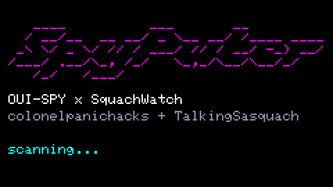
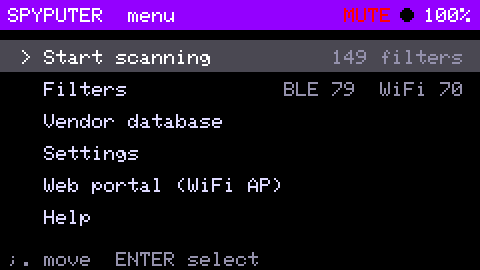
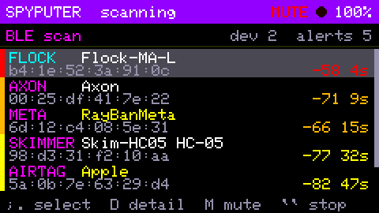
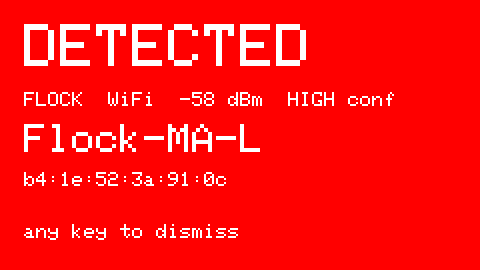
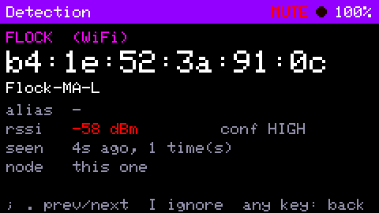
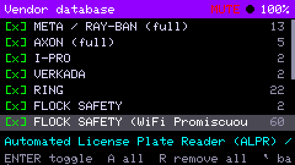
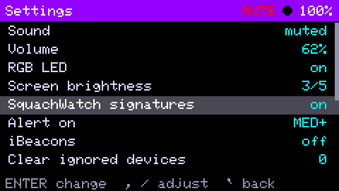
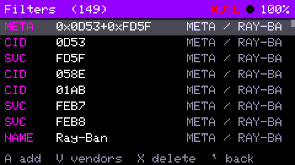
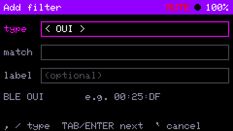

# SpyPuter

```
   ____          ___       __         
  / __/__  __ __/ _ \__ __/ /____ ____
 _\ \/ _ \/ // / ___/ // / __/ -_) __/
/___/ .__/\_, /_/   \_,_/\__/\__/_/   
   /_/   /___/
```



**SpyPuter** is a surveillance-device detector for the **M5Stack Cardputer**
(and Cardputer ADV) that you run from its own screen and keyboard, with no
phone, no WiFi portal and no laptop. It combines two projects:

- **[OUI-SPY Detector](https://github.com/colonelpanichacks/ouispy-detector)** by
  **[colonelpanichacks](https://github.com/colonelpanichacks)**: the detection
  engine (BLE and WiFi time-sliced scanning, user filters, vendor presets),
  ESP-NOW long-range node mesh, MQTT / Home Assistant, Remote ID decoding, the
  web portal and the PC dashboard.
- **[SquachWatch-CYD](https://github.com/skizzophrenic/SquachWatch-CYD)** by
  **[TalkingSasquach](https://github.com/skizzophrenic)**
  ([squachwatch.com](https://squachwatch.com)): the built-in signature
  research. That covers ~100 graded signatures for Flock, Axon, Meta glasses,
  skimmers, Raven, AirTag / SmartTag / Tile / Find Hub trackers, plate readers,
  cameras, Ring, and hacker gear (Flipper, Pwnagotchi, Pineapple), plus the
  deauth-flood and evil-twin detectors and the HIGH / MED / LOW confidence
  grading.

Almost all of the work is theirs. SpyPuter adds the Cardputer hardware layer,
an on-device UI, and the glue that runs SquachWatch's signatures inside
OUI-SPY's scanner. Please star and support the upstream projects.

| | |
|---|---|
|  |  |
|  |  |
|  |  |
|  |  |

Screenshots are captured from the device over serial (`cardshot`). The
scanning screens show fictional sample detections (`carddemo`), not real devices.

## What it detects

Two layers run on every BLE advert and every WiFi frame:

1. **Your filters (OUI-SPY):** OUI, full MAC, BT company ID, 16-bit service
   UUID, name substring, WiFi probe or beacon OUI. A fresh install starts with
   every vendor signature in the OUI-SPY database (~150 filters). Edit them
   under Filters / Vendor database.
2. **Built-in signatures (SquachWatch):** whatever the filters didn't match
   goes through SquachWatch's classifier: OUI tables, WiFi SSIDs (`flock-`,
   `AB3-`, `AXON-`, `Pineapple_`), raw-payload checks (AirTag / Find My, Find
   Hub, Axon `BWCDEVICE`, Flock GATT and name patterns), Pwnagotchi beacons,
   deauth / disassoc floods and evil-twin APs. Each hit carries SquachWatch's
   type (FLOCK, AXON, META, SKIMMER, RAVEN, AIRTAG, DRONE, ALPR, CAMERA, SMTAG,
   GTAG, TILE, RING, DEAUTH, EVILTWN, IBEACON, HACKER) and confidence.

**Confidence decides what interrupts you.** Only 1 of Flock's 49 OUIs is
registered to Flock; the rest are generic Espressif / Liteon / SiLabs blocks
that every dev board uses. SquachWatch grades each signature, and that grade
also applies to filter hits on the same OUI. The default **Alert on: MED+**
setting lists LOW hits (dimmed) but doesn't flash or beep for them.

**Each device alerts once**, the first time it's seen. After that its row
just updates (RSSI, hit count, age). Press `I` on a detection to ignore that
device for good.

## Build and flash

```bash
pio run -e cardputer -t upload          # detector
pio run -e cardputer_skyspy -t upload   # Sky-Spy drone node variant
pio device monitor                      # serial console + TLM feed (115200)
```

For a clean install, run `pio run -e cardputer -t erase -t upload`.

## Using it

Power it on and it starts **scanning**. The sound is **muted by default**.

| Key | Action |
|---|---|
| `;` `.` | up / down |
| `,` `/` | left / right |
| `ENTER` | select |
| `` ` `` / `DEL` | back |

**While scanning:** `;` `.` select, `D`/`ENTER` details, `I` ignore (in
details), `M` mute, `L` LED, `S` stealth (screen and LED off), `H` help, `` ` ` `` stop.

**Menu:**
- **Start scanning**
- **Filters:** `A` add, `X X` delete, `V` vendors
- **Vendor database:** `ENTER` toggles a vendor, `A` adds all, `R R` removes all
- **Settings:** sound, volume, LED, brightness, SquachWatch signatures,
  alert level, iBeacons, ignored devices, Remote ID, mesh, scan on boot,
  clear history, factory reset
- **Web portal:** OUI-SPY's AP (`snoopuntothem` / `astheysnoopuntous`,
  http://192.168.4.1), for MQTT, aliases and fleet management

Holding **G0** for 1.5 s returns to the menu (and clears an OUI-SPY burn-in lock).

## Hardware mapping

| OUI-SPY (XIAO ESP32-S3) | Cardputer |
|---|---|
| piezo, LEDC on GPIO3 | speaker (M5Unified) |
| NeoPixel on GPIO4 | on-board WS2812 on GPIO21 |
| status LED on GPIO21 | indicator on screen |
| BOOT GPIO0 | G0 button |

## Limitations

- **No PSRAM:** OUI-SPY's mesh firmware OTA stages the image in PSRAM, so
  update a Cardputer node over USB.
- **Mesh compatibility:** detections from SquachWatch signatures travel over
  the OUI-SPY mesh as type `SIG` (the SquachWatch type goes in `match`).
- **Promiscuous DATA frames:** these are captured when SquachWatch signatures are on,
  as in SquachWatch.

## Source layout

| Path | Origin |
|---|---|
| `src/main.cpp`, `mesh*`, `mqtt*`, `rid*`, `devinfo.h`, `opendroneid*`, `odid_wifi*` | OUI-SPY (`9e25984`). Port changes are marked `Cardputer port` |
| `src/squachwatch/signatures.{h,cpp}` | SquachWatch-CYD (`d1f03e7`), unmodified |
| `src/squachwatch/state.h` | SquachWatch-CYD, trimmed to the types used |
| `src/squachwatch/sw_detect.{h,cpp}` | adapted from SquachWatch's `detection.cpp` classification order |
| `src/cardputer_hal.h`, `src/cardputer_ui.h` | this port |
| `src/vendor_db.h` | generated by `gen-cardputer-db.py` from OUI-SPY's OUI Database |
| `home-dashboard/`, `*.md` OUI lists, sync scripts | OUI-SPY |

The serial console accepts `cardkey <key>` (inject a keypress) and
`cardshot` (dump the screen as RGB565 hex), which were used for the
screenshots and for automated testing.

## License

The combined firmware is **GPL-3.0** (`LICENSE`), because it includes
SquachWatch-CYD code (GPL-3.0). OUI-SPY's code is MIT-licensed
(`LICENSE-OUISPY-MIT`, © colonelpanichacks) and keeps that notice.

## Credits

- **colonelpanichacks**: [OUI-SPY Detector](https://github.com/colonelpanichacks/ouispy-detector),
  [colonelpanic.tech](https://colonelpanic.tech)
- **TalkingSasquach (skizzophrenic)**: [SquachWatch-CYD](https://github.com/skizzophrenic/SquachWatch-CYD),
  [squachwatch.com](https://squachwatch.com). The SquachWatch credits list the
  researchers behind its signatures (DeFlock, flock-you, @NitekryDPaul and
  others). See its README and `docs/DETECTIONS.md`.
- M5Stack: M5Cardputer / M5Unified / M5GFX
